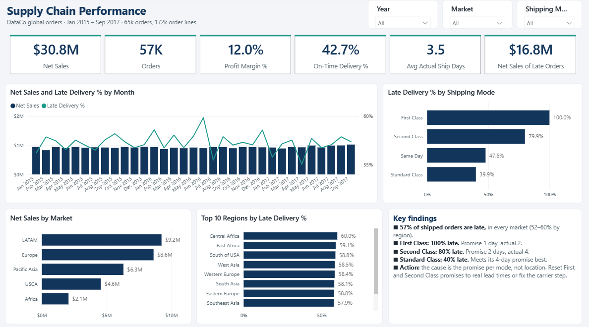
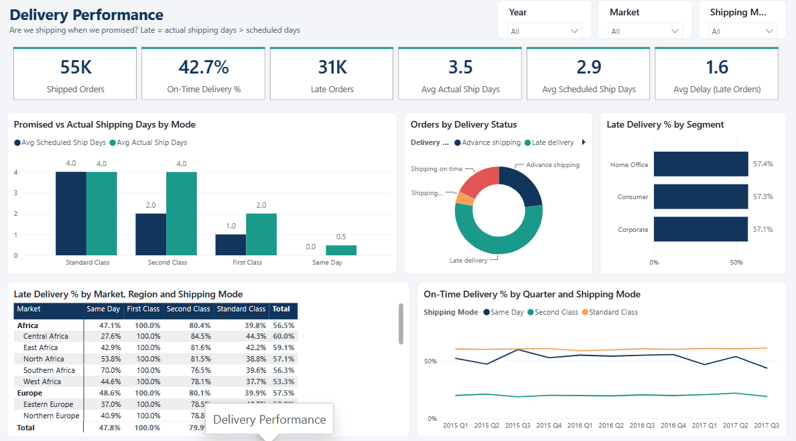
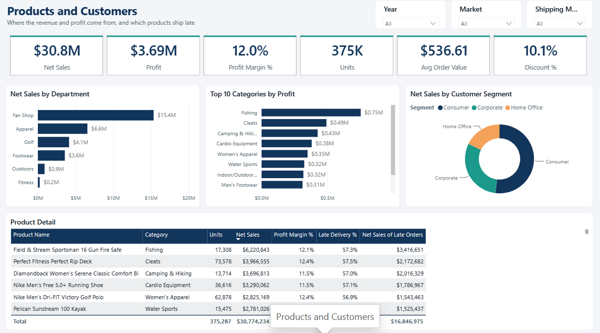

# Supply Chain Performance Dashboard (Power BI)

**Question:** Are we delivering orders when we promised, and where does the delay come from?



## Key findings

- **57% of shipped orders are late.** The rate is almost the same in every market (52–60% by region), so location is not the cause.
- **First Class is late 100% of the time.** It promises 1 day and always takes 2.
- **Second Class is late 80% of the time.** It promises 2 days and takes about 4.
- **Standard Class meets its 4-day promise best** (40% late).
- **Recommendation:** the problem is the delivery promise for each shipping mode, not the warehouse or the region. Either reset the First and Second Class promises to the real lead times, or fix the carrier step that adds the extra days.

## Data

- **Source:** DataCo Smart Supply Chain dataset, Mendeley Data, DOI [10.17632/8gx2fvg2k6.5](https://data.mendeley.com/datasets/8gx2fvg2k6/5). 180,519 order lines; SHA-256 checked after download.
- **Period used:** Jan 2015 – Sep 2017 (171,962 order lines, 57,349 orders).
- **Data decisions:**
  - From Oct 2017 the dataset drops from about 50 products a month to 8–20 and sales fall sharply, so those months are left out. Keeping them would make every trend look like a collapse.
  - Customer names, emails, passwords and street addresses are dropped. They are not needed and they are personal data.
  - "Late" means actual shipping days are greater than scheduled shipping days. Cancelled orders are excluded from on-time %.
  - The date table ends in Sep 2017 with the data, so 2017 year-on-year compares Jan–Sep with Jan–Sep (otherwise 2017 shows a false −22%).

## Model

Star schema: one fact table and five dimensions.

| Table | Rows | Role |
|---|---|---|
| Order Lines | 171,962 | Fact: one row per order line |
| Product | 100 | Product, category, department |
| Customer | 12,330 | Segment, state, country |
| Region | 23 | Order region and market |
| Shipping Mode | 4 | Mode, sort order, planned days |
| Date | 1,004 | Calendar (marked as date table) |
| Key Measures | – | All 22 DAX measures, in display folders |

Example measures:

```DAX
On-Time Delivery % = DIVIDE([On-Time Orders], [Shipped Orders])

Ship Days vs Plan = [Avg Actual Ship Days] - [Avg Scheduled Ship Days]

Net Sales YoY % =
VAR PY = [Net Sales PY]
RETURN IF(NOT ISBLANK(PY), DIVIDE([Net Sales] - PY, PY))
```

## Pages

1. **Overview:** KPIs, sales vs late % by month, late % by shipping mode, top regions, findings.
2. **Delivery Performance:** promised vs actual days, delivery status mix, late % by market, region and mode, on-time trend.
3. **Products and Customers:** sales by department, top categories by profit, segment mix, product detail table.




## Checks

- Every KPI was checked against the same calculation in Python (pandas) on the cleaned data, for example late % by shipping mode: First 100.0%, Second 79.9%, Standard 39.9%, Same Day 47.8% in both.

## How to open

1. Open `Supply Chain Performance.pbip` in Power BI Desktop (it opens with the data already loaded).
2. To reload from the CSV files: if you moved the folder, update the `DataFolder` parameter (Transform data > Manage parameters), then Refresh.
3. To rebuild from scratch: `python scripts/prepare_data.py` then `python scripts/build_report.py`.

Tools: Power BI (Power Query, DAX, star schema), Python (pandas) for cleaning and checks.
