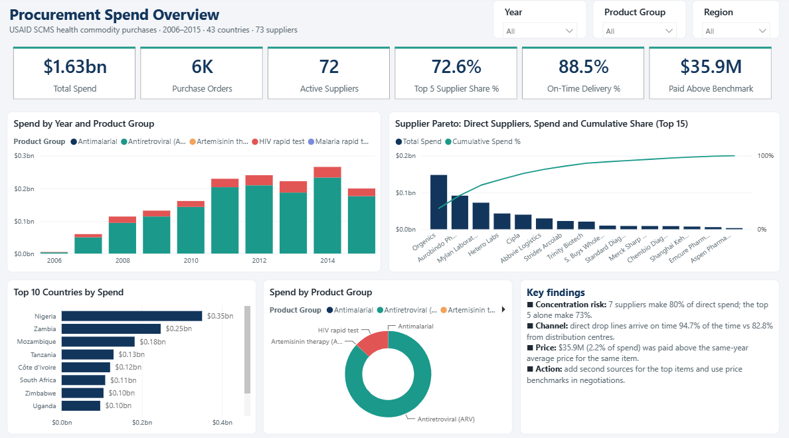
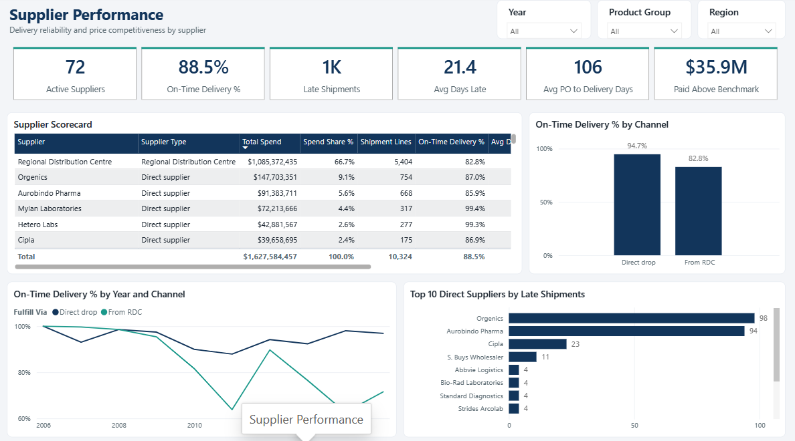
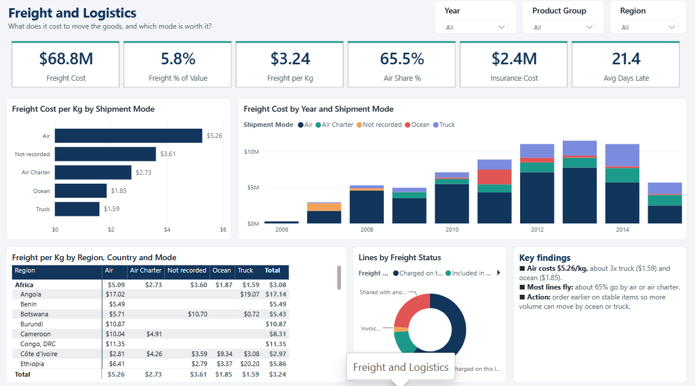

# Procurement and Supplier Performance Dashboard (Power BI)

**Question:** Where does the money go, how reliable are our suppliers, and what does freight cost us?



## Key findings

- **$1.63bn of health commodities** bought from 2006 to 2015 for 43 countries.
- **Concentration risk:** 7 suppliers make 80% of direct-supplier spend; the top 5 alone make 73%.
- **Channel:** lines shipped direct from the supplier arrived on time 94.7% of the time, against 82.8% for lines shipped from regional distribution centres.
- **Price:** $35.9M (2.2% of spend) was paid above the same-year average price for the same item.
- **Freight:** air costs $5.26 per kg, about 3x truck ($1.59) and ocean ($1.85), yet about 65% of lines go by air or air charter.
- **Recommendations:** add second sources for the top items, use the price benchmark in negotiations, and order earlier on stable items so more volume can move by ocean or truck.

## Data

- **Source:** USAID "Supply Chain Shipment Pricing Data" (SCMS delivery history), U.S. Government open data. 10,324 shipment lines, 33 columns. The same file (SHA-256 `918b992d…`) was downloaded from two independent copies and matched.
- **Data decisions:**
  - Late = delivered to client after the scheduled delivery date.
  - Freight and weight are numbers only on some lines. Other lines say "Freight Included in Commodity Cost", "Invoiced Separately" or "See ASN-…" (shared with another line). These are kept as a **Freight Status** label and left out of freight-rate maths.
  - **Price benchmark** = quantity-weighted average pack price of the same item **in the same year**. A first version averaged all years and showed $130.6M "overpaid", but medicine prices fell a lot from 2006 to 2015, so that compared old orders with new prices. The same-year benchmark gives a fair $35.9M.
  - "SCMS from RDC" is not a supplier; it means the line came from a Regional Distribution Centre. It is labelled as its own supplier type and excluded from supplier concentration and the Pareto chart.
  - Long vendor names are shortened for charts (for example "MYLAN LABORATORIES LTD (FORMERLY MATRIX LABORATORIES)" becomes "Mylan Laboratories").

## Model

| Table | Rows | Role |
|---|---|---|
| Shipment Lines | 10,324 | Fact: one row per shipment line |
| Vendor | 73 | Supplier, short name, supplier type |
| Item | 184 | Product group, molecule, brand, dosage form |
| Country | 43 | Country and region |
| Date | 3,544 | Calendar on delivered date |
| Key Measures | – | 18 DAX measures |

Example measures:

```DAX
Top 5 Supplier Share % =
VAR t = ADDCOLUMNS(
    CALCULATETABLE(VALUES(Vendor[Supplier]), Vendor[Supplier Type] = "Direct supplier"),
    "@s", [Total Spend])
RETURN DIVIDE(SUMX(TOPN(5, t, [@s]), [@s]), SUMX(t, [@s]))

Cumulative Spend % =            -- Pareto line
VAR cur = [Total Spend]
VAR t = ADDCOLUMNS(ALLSELECTED(Vendor[Supplier]), "@s", [Total Spend])
RETURN IF(NOT ISBLANK(cur), DIVIDE(SUMX(FILTER(t, [@s] >= cur), [@s]), SUMX(t, [@s])))

Freight per Kg = DIVIDE(SUM('Shipment Lines'[Freight For Rate]), SUM('Shipment Lines'[Weight For Rate]))
```

## Pages

1. **Spend Overview:** KPIs, spend by year and product group, supplier Pareto, top countries, findings.
2. **Supplier Performance:** supplier scorecard (spend, share, on-time %, days late, price vs benchmark), on-time by channel and year, suppliers with the most late lines.
3. **Freight and Logistics:** freight per kg by mode, freight cost by year and mode, freight per kg by country and mode, freight status mix.




## Checks

All headline numbers match the same calculation in Python (pandas): total spend, on-time % (88.5%), top-5 share (72.6%), on-time by channel, freight per kg by mode and amount paid above the benchmark.

## How to open

1. Open `Procurement and Supplier Performance.pbip` in Power BI Desktop.
2. If you moved the folder, update the `DataFolder` parameter, then Refresh.
3. Rebuild: `python scripts/prepare_data.py` then `python scripts/build_report.py`.

Tools: Power BI (Power Query, DAX, star schema), Python (pandas).
