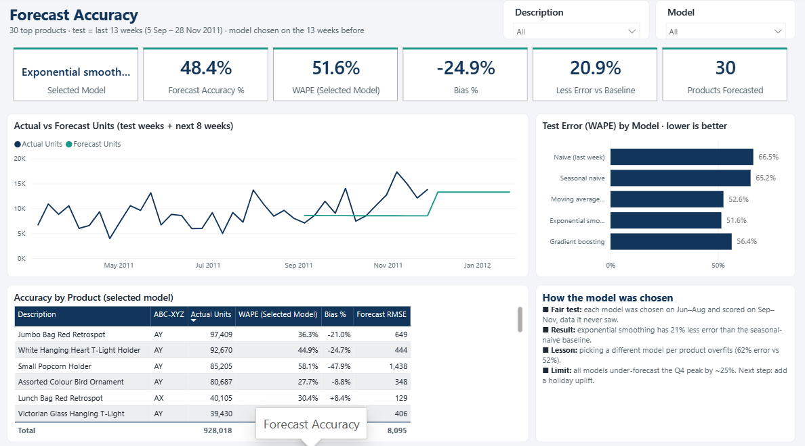
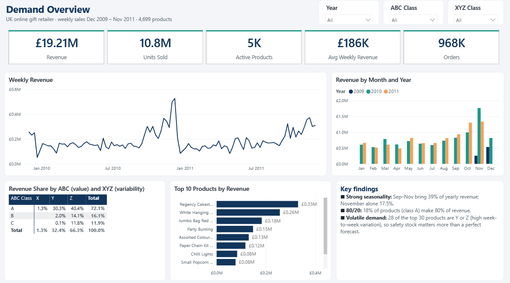
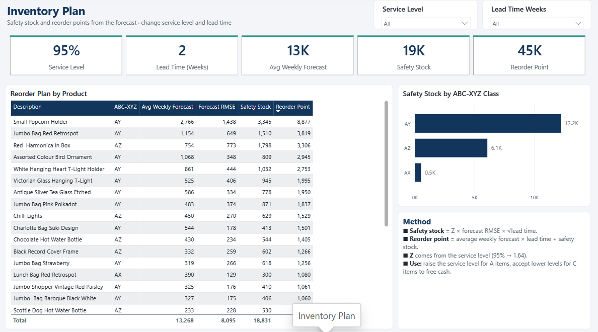

# Demand Forecasting and Inventory Planning (Python + Power BI)

**Question:** How much of each product will we sell in the coming weeks, how accurate is that forecast, and how much safety stock do we need?



## Key findings

- **Strong seasonality:** September to November bring 39% of yearly revenue; November alone 17.5%.
- **80/20:** 18% of products (class A) make 80% of revenue.
- **Volatile demand:** 28 of the top 30 products are class Y or Z (high week-to-week variation), so safety stock matters as much as the forecast itself.
- **Forecast result:** exponential smoothing has a 51.6% weighted error (WAPE) on 13 test weeks, which is **21% less error than the seasonal-naive baseline** (65.2%).
- **What did not work:** picking a different model for each product overfits (62% error on the test, against 52% for one model for all products).
- **Limit:** every model under-forecasts the Q4 peak by about 25% (bias −24.9%). The next step is to add a holiday uplift.

## Data

- **Source:** UCI Machine Learning Repository, [Online Retail II](https://archive.ics.uci.edu/dataset/502/online+retail+ii) (CC BY 4.0). A UK online gift retailer, 1,067,371 invoice lines, Dec 2009 – Dec 2011.
- **Cleaning:**
  - Removed cancellation invoices (starting with "C") **and the original lines they cancel** (same customer, product and quantity). Without this, large orders that were later cancelled stay in the data as fake demand spikes.
  - Removed non-product codes (postage, fees, manual adjustments), zero prices and zero quantities.
  - Stock codes put in upper case: the data has both `84030b` and `84030B`, and Power BI treats them as duplicates.
  - Weekly demand (weeks start Monday); the last partial week is dropped. Result: 105 weeks, 4,699 products.

## Method

1. **ABC classes** by revenue (last 52 weeks): A = top 80%, B = next 15%, C = rest. **XYZ classes** by coefficient of variation of weekly units: X < 0.5, Y 0.5–1.0, Z > 1.0.
2. **Products forecast:** the 30 highest-revenue products that sell in at least 85% of weeks.
3. **Models compared:** naive (last week), seasonal naive (same week last year), 8-week moving average, Holt exponential smoothing with damped trend (parameters by grid search), and one global gradient boosting model across all 30 products (features: recent level, same week last year, horizon, week of year).
4. **Fair test:** the model is chosen on a validation window (Jun–Aug 2011) and scored on a test window it never saw (5 Sep – 28 Nov 2011). Exponential smoothing won both windows.
5. **Future:** the chosen model is refitted on all weeks and forecasts the next 8 weeks.
6. **Inventory plan** (in DAX, with what-if slicers for service level and lead time):
   - Safety stock = Z × forecast RMSE × √lead time (weeks)
   - Reorder point = average weekly forecast × lead time + safety stock

| Model | Test WAPE |
|---|---|
| Exponential smoothing (selected) | 51.6% |
| Moving average (8 weeks) | 52.6% |
| Gradient boosting | 56.4% |
| Seasonal naive | 65.2% |
| Naive (last week) | 66.5% |

## Model (Power BI)

| Table | Rows | Role |
|---|---|---|
| Weekly Sales | 194k | Fact: units, revenue per product per week |
| Forecast | 3,150 | Fact: forecast per product, model and week (test + future) |
| Model Accuracy | 150 | Fact: WAPE, bias, RMSE per product and model |
| Product | 4,699 | Description, ABC, XYZ, forecasted flag |
| Week, Model | – | Dimensions |
| Service Level, Lead Time | – | What-if parameter tables |
| Key Measures | – | 22 DAX measures |

```DAX
Safety Stock =
VAR z = [Service Level Z]
VAR lt = [Lead Time (Weeks)]
RETURN SUMX(VALUES('Product'[StockCode]), z * [Forecast RMSE] * SQRT(lt))
```

## Pages

1. **Demand Overview:** weekly revenue, monthly seasonality by year, ABC × XYZ revenue share, top products.
2. **Forecast Accuracy:** actual vs forecast, error by model, accuracy by product, how the model was chosen.
3. **Inventory Plan:** pick a service level (90–99%) and lead time (1–8 weeks); safety stock and reorder point update for every product.




## How to open

1. Open `Demand Forecasting and Inventory Planning.pbip` in Power BI Desktop.
2. If you moved the folder, update the `DataFolder` parameter, then Refresh.
3. Rebuild: convert the UCI .xlsx to `data/raw/online_retail_II.csv`, run `python scripts/prepare_and_forecast.py`, then `python scripts/build_report.py`.

Tools: Python (pandas, NumPy, scikit-learn), Power BI (DAX, what-if parameters).
