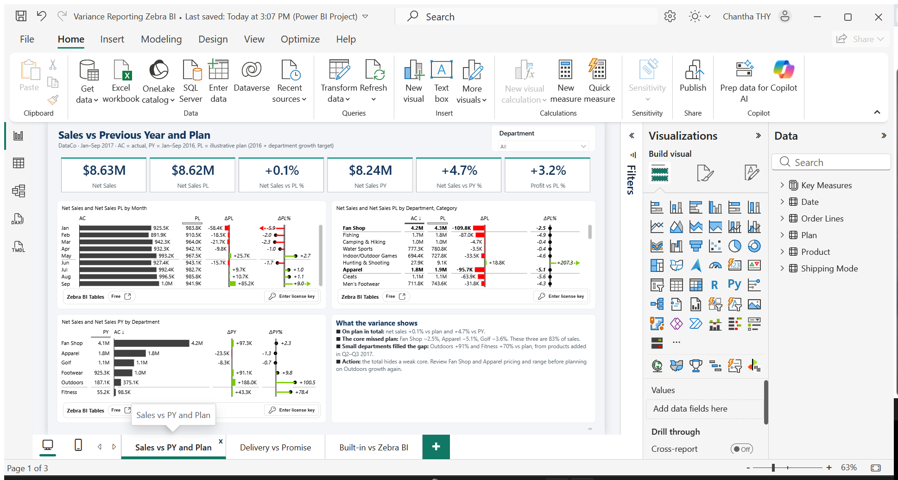
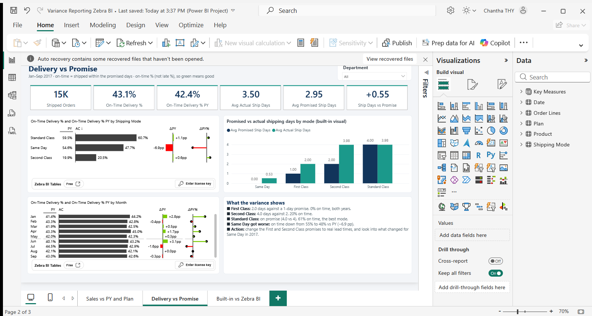
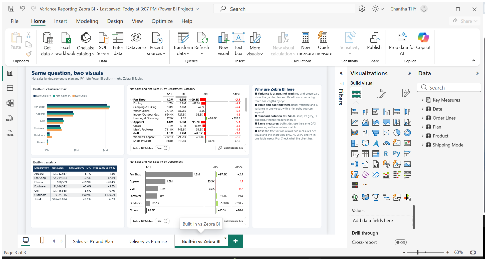

# Variance Reporting with Zebra BI (Power BI)

**Question:** Are we on plan and ahead of last year, and where does the gap come from?

This project shows the same supply chain data as project 1 in the way finance and controlling teams read it: **actual (AC) vs previous year (PY) vs plan (PL)**, with the variance drawn in green and red. The variance views use the **Zebra BI Tables** custom visual (IBCS notation). One page puts built-in Power BI visuals next to Zebra BI so the difference is easy to see.



## Key findings (Jan–Sep 2017)

- **On plan in total, but the core missed.** Net sales are $8.63M: +0.1% vs plan and +4.7% vs the same months of 2016.
- **The three biggest departments are all below plan:** Fan Shop −2.5%, Apparel −5.1%, Golf −3.6%. Together they are 83% of sales.
- **Two small departments filled the gap:** Outdoors +91% and Fitness +70% vs plan, from products added in Q2–Q3 2017.
- **Delivery:** First Class ships in 2.0 days against a 1-day promise and is never on time. Second Class takes 4.0 days against 2. Standard Class keeps its 4-day promise. **Same Day got worse:** on-time down from 55% to 48% (−6.9 pp).
- **Recommendation:** the total hides a weak core. Review Fan Shop and Apparel before counting on Outdoors growth again, and reset the First and Second Class delivery promises to real lead times.

## Data

- **Source:** the cleaned DataCo files from [project 1](../01_Supply_Chain_Performance/) (DataCo Smart Supply Chain, Mendeley Data, DOI [10.17632/8gx2fvg2k6.5](https://data.mendeley.com/datasets/8gx2fvg2k6/5)). `scripts/prepare_data.py` copies the columns this report needs.
- **AC** = 2017 actual, Jan–Sep (the data ends in Sep 2017). **PY** = Jan–Sep 2016.
- **PL (sales plan):** the dataset has no budget, so the plan follows a written rule: *2016 actual for the same month and product × (1 + department growth target)*. Targets are 3–6% by department. **This plan is illustrative, not a real company budget.**
- **PL (delivery):** the shipping days promised to the customer. These come from the real data.
- **Why there is no market or region view:** in DataCo the market of the orders changes from quarter to quarter (2015 Q1 is all LATAM, 2016 Q1 all Pacific Asia, 2017 Q3 all Europe). A variance by market would only show that shift, not performance. `prepare_data.py` prints this table. Department and shipping mode are stable, so the variance views use those.

## Model

| Table | Rows | Role |
|---|---|---|
| Order Lines | 171,962 | Fact: one row per order line |
| Plan | 486 | Fact: plan per month and product (2017) |
| Product | 100 | Department, category, product |
| Shipping Mode | 4 | Mode and sort order |
| Date | 1,004 | Calendar (marked as date table, ends Sep 2017) |
| Key Measures | – | 22 DAX measures in two folders |

Both fact tables link to Date and Product, so plan and actual filter together.

```DAX
Net Sales PY = CALCULATE([Net Sales], SAMEPERIODLASTYEAR('Date'[Date]))
Net Sales PL = SUM('Plan'[Net Sales Plan])
Net Sales vs PL % =
VAR PL = [Net Sales PL]
RETURN IF(NOT ISBLANK(PL), DIVIDE([Net Sales] - PL, PL))
On-Time Delivery % = DIVIDE([On-Time Orders] + 0, [Shipped Orders])
```

## Pages

1. **Sales vs PY and Plan:** KPI cards, net sales by month vs plan, department → category vs plan (you can expand it), department vs PY, findings.
2. **Delivery vs Promise:** on-time % by mode and by month vs PY (Zebra BI), promised vs actual days (built-in), findings.
3. **Built-in vs Zebra BI:** the same question as a built-in bar chart and matrix, and as Zebra BI.




## About Zebra BI (free version)

Power BI Desktop downloads the visual from AppSource when you open the report (internet needed). The report is built to work with the **free** version. Testing Zebra BI Tables 8.4.2.53 showed these limits:

| Limit in the free version | How this report handles it |
|---|---|
| Two measures per visual (AC + one comparison) | Separate visuals for AC vs PL and AC vs PY |
| Chart view only (table view needs a paid plan) | Chart view is used everywhere |
| No colour invert for "lower is better" measures | On-time % is shown instead of late %, so green means good |
| Zero values are hidden | First Class (0% on time) does not show in the Zebra chart. The built-in chart and the findings show it |

With a Pro licence, `build_report.py` can switch to a single table with AC, PL and PY (`table=True`) and invert colours for cost or late measures (`invert=True`).

## How to open

1. Open `Variance Reporting Zebra BI.pbip` in Power BI Desktop.
2. If you moved the folder, change the `DataFolder` parameter (Transform data → Manage parameters) to this project's `data\clean\` folder, then Refresh.

## Rebuild and check

```
python scripts/prepare_data.py    # data + plan, prints the check numbers
python scripts/build_report.py    # writes the .pbip (TMDL model + PBIR report)
```

`scripts/tests.dax` holds the DAX queries used to check the model. Every total, department and shipping-mode figure matched the pandas numbers printed by `prepare_data.py`.
