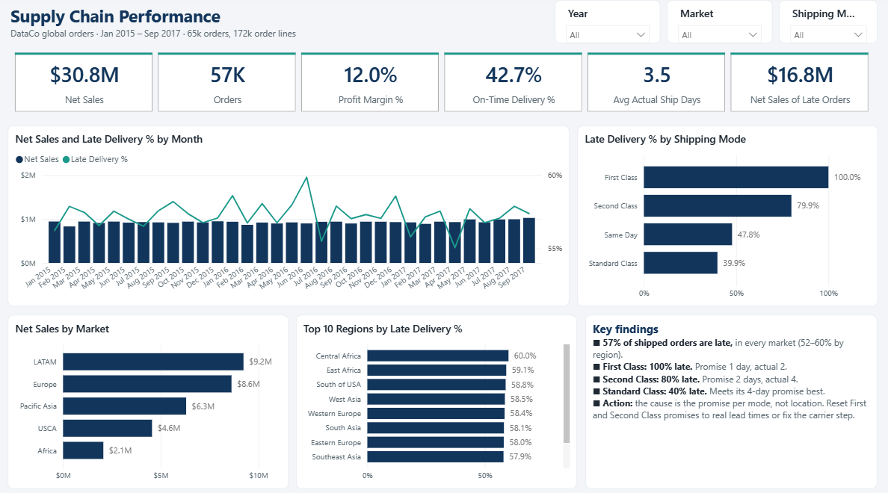

# Thy Chantha · Power BI Supply Chain Portfolio

Three end-to-end Power BI projects on public supply chain data. Each one starts from raw data, cleans it in Python, builds a star-schema model with DAX measures, and ends with a business recommendation. Every headline number was checked against the same calculation in Python.

| # | Project | Business question | Data |
|---|---|---|---|
| 1 | [Supply Chain Performance](01_Supply_Chain_Performance/) | Are orders delivered on time, and why not? | DataCo, 172k order lines |
| 2 | [Procurement and Supplier Performance](02_Procurement_Supplier_Performance/) | Where does spend go, how reliable are suppliers, what does freight cost? | USAID SCMS, 10k shipment lines, $1.63bn |
| 3 | [Demand Forecasting and Inventory Planning](03_Demand_Forecasting/) | How much will we sell, how accurate is the forecast, how much safety stock do we need? | UCI Online Retail II, 1M invoice lines |

## Highlights

- **Delivery:** found that First Class shipping is late 100% of the time (promise 1 day, actual 2), so the fix is the delivery promise, not the region.
- **Procurement:** 7 suppliers make 80% of spend; air freight costs 3x truck per kg; a fair same-year price benchmark shows $35.9M paid above average.
- **Forecasting:** exponential smoothing cut forecast error by 21% against a seasonal baseline, tested on weeks the model never saw; safety stock and reorder points update with service level and lead time.



## Skills shown

- Power BI: Power Query, star schema modelling, DAX (time intelligence, Pareto, Top N, what-if parameters), report design
- Supply chain KPIs: on-time delivery, lead time vs plan, supplier concentration, price benchmark, freight per kg, ABC-XYZ, safety stock, reorder point
- Python: pandas data cleaning, data quality checks, forecasting (exponential smoothing, gradient boosting), honest model validation
- Documentation: every data decision is written down in each project README

## Repository layout

```
Portfolio/
  _tools/                     shared builder: theme, TMDL/PBIR writer, validators, test scripts
  01_Supply_Chain_Performance/
    Supply Chain Performance.pbip      <- open this in Power BI Desktop
    *.SemanticModel/ *.Report/         Power BI project files (TMDL + PBIR)
    data/clean/                        cleaned CSVs used by the model
    scripts/                           Python: prepare data, build report, DAX tests
    images/                            screenshots
  02_.../ 03_.../                      same structure
```

The Power BI files are saved as Power BI Projects (.pbip), so the model (TMDL) and report (PBIR) are plain text and can be reviewed in Git.
